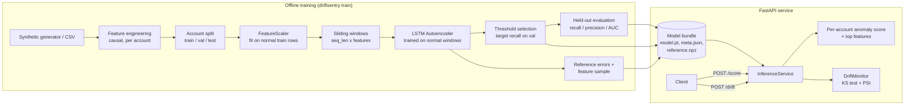

# DriftSentry

LSTM autoencoder for financial transaction anomaly detection and distribution-shift monitoring,
served as a FastAPI inference service.

DriftSentry learns what "normal" per-account transaction sequences look like. Windows of
consecutive transactions that the autoencoder reconstructs poorly are flagged as anomalous
(deposit bursts, structuring just under the reporting threshold, odd-hour wires, amount
spikes). The same reconstruction errors, plus raw feature distributions, are compared against a
training-time reference with the KS test and Population Stability Index to detect drift.

## Features

- **Synthetic data generator** with per-account personas and four labeled anomaly types
  (no real financial data needed).
- **Causal feature engineering**: log amount, deposit flag, cyclic hour/day encodings, time
  since previous transaction, per-account amount z-score (past only), near-threshold flag, and
  channel one-hots.
- **Sliding-window sequences** per account, split by account (no leakage across splits).
- **LSTM autoencoder** (encoder LSTM -> latent -> repeated -> decoder LSTM) trained only on
  normal windows with early stopping.
- **Recall-targeted threshold**: picks the highest threshold that achieves a target recall
  (default 94%) on validation anomalies, then reports precision/recall/F1/ROC-AUC and per-type
  recall on held-out test accounts.
- **Drift monitor**: KS test + PSI on reconstruction errors and on every input feature.
- **FastAPI service** with per-account scores, top contributing features, and drift reports.

## Architecture



## Project layout

```
driftsentry/
  config.py            dataclass configs + feature list
  data/synthetic.py    transaction generator with anomaly injection
  data/features.py     causal per-transaction features
  data/windowing.py    scaler, sliding windows, account split
  model/autoencoder.py LSTMAutoencoder
  train.py             training loop with early stopping
  scoring.py           reconstruction errors, threshold selection
  evaluate.py          detection metrics
  drift.py             KS / PSI drift monitor
  artifacts.py         save / load model bundle
  pipeline.py          end-to-end train + evaluate
  api/                 FastAPI app, schemas, service, settings
  cli.py               command line entry point
tests/                 pytest suite
```

## How to run

Requires Python 3.10+. Runs on CPU; a GPU is optional (`--device cuda` / `mps`).

```bash
python -m venv .venv && source .venv/bin/activate
pip install -e ".[dev]"
cp .env.example .env

# 1. Generate synthetic transactions (train set, a held-out set, and a drifted set)
driftsentry generate --out data/transactions.csv
driftsentry generate --out data/holdout.csv --seed 7
driftsentry generate --out data/shifted.csv --seed 8 --amount-shift 1.5 --no-anomalies

# 2. Train (prints validation threshold and held-out test metrics)
driftsentry train --data data/transactions.csv --out artifacts

# 3. Evaluate on another labeled set, and run a drift check
driftsentry evaluate --artifacts artifacts --data data/holdout.csv
driftsentry drift --artifacts artifacts --data data/shifted.csv

# 4. Serve
driftsentry serve --artifacts artifacts --port 8000
# or: uvicorn driftsentry.api.main:app --port 8000
```

### API

| Method | Path          | Description                                           |
|--------|---------------|-------------------------------------------------------|
| GET    | `/health`     | Liveness and whether a model bundle is loaded         |
| GET    | `/model/info` | Threshold, window config, features, training metrics  |
| POST   | `/score`      | Per-account anomaly scores for a batch of transactions |
| POST   | `/drift`      | KS/PSI drift report for a batch vs. the reference     |

Example:

```bash
curl -X POST localhost:8000/score -H 'content-type: application/json' -d '{
  "transactions": [
    {"account_id": "acct_1", "timestamp": "2025-03-01T10:15:00", "amount": 120.5,
     "txn_type": "deposit", "channel": "online"},
    {"account_id": "acct_1", "timestamp": "2025-03-01T10:40:00", "amount": 9850,
     "txn_type": "deposit", "channel": "branch"}
  ],
  "include_windows": true
}'
```

Each account in the response has `max_error`, `anomaly_score` (`max_error / threshold`, > 1
means anomalous), `flagged_windows`, and the `top_features` with the highest reconstruction
error in its worst window. Accounts with fewer than `seq_len` transactions are left-padded.

### Docker

```bash
driftsentry train --out artifacts
docker build -t driftsentry .
docker run -p 8000:8000 -v "$PWD/artifacts:/app/artifacts" driftsentry
```

### Configuration

Environment variables (see `.env.example`): `DRIFTSENTRY_ARTIFACTS_DIR`, `DRIFTSENTRY_DEVICE`,
`DRIFTSENTRY_MAX_TRANSACTIONS`, `DRIFTSENTRY_LOG_LEVEL`. Model, window and training
hyperparameters live in `driftsentry/config.py` and the `train` CLI flags.

## How to test

```bash
pip install -e ".[dev]"
pytest -q
```

The suite trains a tiny model on a small synthetic dataset (a few seconds on CPU) and covers
feature causality, windowing, the autoencoder, threshold selection, PSI/KS drift detection,
bundle save/load, and every API endpoint including validation and error paths.

## Notes

- The 94% recall figure is a *target*: the threshold is calibrated on validation anomalies to
  reach it, and the achieved recall on held-out test accounts is reported in
  `artifacts/meta.json` under `metrics.test`.
- Drift is flagged when the KS p-value is below 0.01 **and** PSI is at least 0.1, which avoids
  alerting on tiny but statistically significant differences in large batches.
